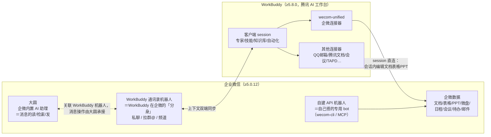

# 1 三个角色：WorkBuddy、大圆、企微 bot 是什么关系

> 本篇基于：企微桌面端 5.0.12 + WorkBuddy 5.8.0（2026-11-13 核查），版本说明见 [[00-总览/02-版本基准-本库基于什么版本|版本基准]]。

**给所有部门的一句话**：我们说的"AI 办公"其实是**三个不同的东西**在配合——**WorkBuddy**（腾讯的 AI 工作台，主场在它自己的客户端）、**大圆**（企业微信内置的 AI 助理，管企微里的聊天消息）、**企微机器人**（跑在企微里的 bot：WorkBuddy 的"分身" + 自己搭的 API 机器人）。**搞不清角色，就搞不清找谁配置、找谁授权、出了错查哪里**——这篇就是那张"对号入座"的地图。

## 一、一张图看懂

## 二、三个角色分工表

| 角色 | 是什么 | 主场 | 管什么 / 不管什么 | 本库目录 |
| :--- | :--- | :--- | :--- | :--- |
| **WorkBuddy** | 腾讯 AI 办公工作台（≥5.8.0，企微账号登录） | WorkBuddy 客户端 | 会话（session）里调专家/专家团、技能、知识库、自动化；**文档、表格、PPT、微盘、日程等业务数据操作走 wecom-unified 连接能力**；不管聊天消息的收发（那是大圆的事） | [[01-WorkBuddy维度/01-WorkBuddy是什么-客户端与会话\|01-WorkBuddy维度]] |
| **大圆** | 企业微信**内置**的原生 AI 智能助理（5.0.9 上线，内测灰度） | 企业微信 | **全能助理**：总结聊天、读写文档表格、定时任务、联网搜索；联动 WorkBuddy 时**聊天消息的读/检索/发由大圆承接**。⚠️ **权限特别高，但没有企业管理后台**（管理员只能设云端保存期限）——风险与管理单独成篇 | [[02-大圆维度/01-大圆联动-消息的读检索发由大圆承接\|02-大圆维度]] |
| **企微机器人** | 企微里的 bot 载体，两种 | 企业微信 | ①**WorkBuddy 通讯录机器人**：WorkBuddy 在企微的分身，与客户端上下文双端同步；②**自建 API 机器人**：wecom-cli/MCP 自己搭的专用 bot（前库场景），要建号+两轮审批+授权三步 | [[03-企微bot维度/01-通讯录机器人-WorkBuddy在企微里的分身\|03-企微bot维度]] |

## 三、六种使用形态，归位到三个角色

| 形态 | 归属角色 | 一句话 |
| :--- | :--- | :--- |
| ① 企微侧边栏入口 | WorkBuddy（入口） | 桌面端侧边栏 → 智能机器人 → WorkBuddy，领取席位即用 |
| ② 企微通讯录机器人 | 企微bot（WorkBuddy 分身） | 私聊派活、拉群 @、进频道 |
| ③ 大圆关联 | 大圆 | 在大圆里关联 WorkBuddy 机器人，消息类操作全走大圆 |
| ④ WorkBuddy 客户端 session | WorkBuddy | 企微账号登录，专家/技能/知识库/自动化全家桶 |
| ⑤ session 直连企微连接器 | WorkBuddy | 会话内直接读写企微文档表格 PPT（wecom-unified） |
| ⑥ 自建 API 模式机器人 | 企微bot（自建） | 前库老场景：建号 → 两轮审批 → 授权三步 |

## 四、两条执行路径（最容易混的点）

> 口诀：**"聊天的走大圆，干活的走 wecom-unified。"**

| 路径 | 承接方 | 管什么 | 例子 |
| :--- | :--- | :--- | :--- |
| 消息路径 | **大圆** | 聊天消息的读取、检索、发送 | 总结群聊、检索某群某时段记录、代发消息（需本人确认） |
| 数据路径 | **wecom-unified**（session 直连连接器） | 文档、表格、PPT、微盘、日程、会议、待办、邮件等业务数据 | 会话内读纪要生成智能文档、改表格、产物上传微盘 |

两边授权**各自独立**：一边通了不代表另一边也通；排查问题时先分清走的是哪条路径。

## 五、出了问题去哪查（角色 × 问题 → 目录）

| 你的问题 | 去哪 |
| :--- | :--- |
| 席位、账号、积分、价格 | [[01-WorkBuddy维度/03-账号与计费-企微账号不互通\|WorkBuddy篇：账号与计费]] |
| 会话内改文档表格出问题 | [[01-WorkBuddy维度/04-session直连企微连接器-会话内编辑文档表格\|WorkBuddy篇：session直连连接器]] |
| 消息整理/代发不生效 | [[02-大圆维度/01-大圆联动-消息的读检索发由大圆承接\|大圆篇]] |
| 机器人建号、审批、授权 | [[03-企微bot维度/02-自建API机器人-原有三步流程照走\|bot篇：自建API机器人]] |
| "这个到底能不能做"（红线） | [[04-通用规则/02-红线速查-批了也没用别硬闯\|通用规则：红线速查]] |
| 报错先自查 | [[05-公司管理流程/05-报错自查-五步排查先自己来\|管理流程：报错自查]] |

## 六、和前库（企微 bot SOP）的关系

前库 [bot-OA-SOP](https://github.com/ddd-agent-assets/bot-OA-SOP) 管的就是本库角色三里的"自建 API 机器人"——那套"建号 → 两轮审批 → 授权三步 + 七条红线"**原样有效**，浓缩在 [[03-企微bot维度/02-自建API机器人-原有三步流程照走|bot篇：自建API机器人]]，全量细节看前库。WorkBuddy 和大圆是融合时代**新增**的两个角色，规矩（读要授权、写只写自建、不冒充员工）三角色通用，见 [[04-通用规则/01-授权边界-敏感操作本人授权代发要确认|通用规则：授权边界]]。
